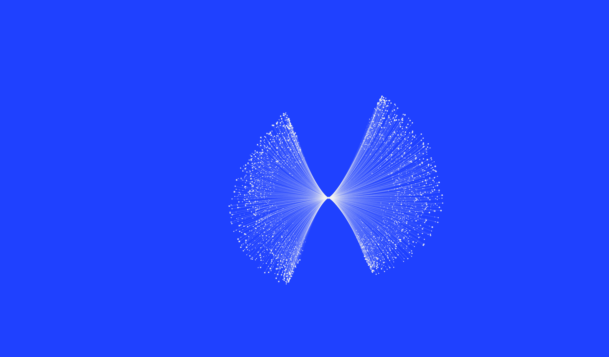

# Growth Field

A creative instrument for exploring exponential growth, multiplicity, and network effects in three dimensions. Orbit floating forms, shape their growth, and export stills or video. All data is synthetic; this is an art-direction tool, not a forecast or a calibrated biological simulation.

[Open the tool](https://justin-close.github.io/nrf-growth-field/)



## Seven growth systems

| System | Form |
| --- | --- |
| Exponential growth | Compounding generations connected by curved strands |
| Multiplicity | Recursive splitting across spatial dimensions |
| Network effect | Connections within and between expanding spherical generations |
| Cascading folds | A continuous surface with increasingly complex ruffles |
| Radial proliferation | Fine trajectories radiating from a shared origin |
| Dissemination shell | An offset source opening into a spherical fan |
| Bifurcation field | Two dense wings growing from a central pinch |

All systems float without a ground grid. Cascading folds and the three filament fields also omit axis markers.

## Run locally

No build or dependency installation is required. Serve this directory over HTTP:

```sh
git clone https://github.com/justin-close/nrf-growth-field.git
cd nrf-growth-field
python3 -m http.server 8000 --bind 127.0.0.1
```

Open <http://localhost:8000>. Use a local server rather than opening `index.html` directly so browser ES modules load correctly.

## Explore

- Drag to orbit, Shift-drag to pan, and scroll to zoom. On touchscreens, use one finger to orbit and two to pan or zoom.
- Adjust growth factor and generations for the original systems; fold count and amplitude for Cascading folds; trajectory density for the filament fields.
- Choose Cascade, Unfurl, or Pulse motion where available. Adjust energy, stagger, and a 6–24 second duration, or scrub to a specific moment.
- Enable a grow-and-return loop or turntable rotation. Auto orbit is a separate preview control.
- Choose one of seven NRF color stories and Connected, Dots, or Filaments drawing styles.
- Save up to 12 studies in browser storage. Share encodes the settings and camera into a URL fragment. No study data is sent to a server.

Keyboard: arrows rotate, `+` / `−` zoom, `F` fits, `H` toggles focus, and Space plays or pauses when a control is not focused.

## Export

- **PNG:** 1920 or 3840 pixels wide, using the current camera and growth moment; optional transparent background.
- **SVG:** editable projected paths and dots, using the same animated pose as the preview.
- **MP4:** silent H.264 video at 30 fps, with a 1280 or 1920 pixel long edge. Choose the current canvas, landscape, square, or portrait framing.

MP4 encoding runs locally with WebCodecs and requires a browser with H.264 encoding support in a secure context (`localhost` or HTTPS). The export panel checks availability before rendering. PNG and SVG remain available when video encoding is unsupported.

## Tests

With Node.js 22 or newer:

```sh
npm test
```

The tests use Node's built-in runner; there are no npm dependencies. They cover model determinism, control bounds, cascading-surface regressions, motion completion, loop seams, camera framing, shared preview/export poses, and video scheduling and cleanup. Video tests use a WebCodecs test double; actual codec support depends on the browser.

## Structure

- `model.mjs`: state validation and generational models.
- `cascading.mjs` / `cascading-scene.mjs`: continuous folded surface and renderer.
- `fields.mjs` / `fields-scene.mjs`: point-and-filament models and renderer.
- `motion.mjs`: deterministic timeline shared by playback and export.
- `video-export.mjs`: frame scheduling, H.264 encoding, and MP4 muxing.
- `app.js`: interaction, camera, persistence, and image exports.
- `vendor/`: locally bundled Three.js, OrbitControls, and MP4 muxer.

The public edition uses Inter Tight and IBM Plex Mono. Third-party licenses and font notices are listed in [THIRD_PARTY_NOTICES.md](THIRD_PARTY_NOTICES.md).

## Hosting

This is a static site. It can be hosted from the repository root on GitHub Pages or another static host. The `.nojekyll` file keeps GitHub Pages from processing the application as a Jekyll site.

## Filament finishes

All diagram markers are circular. In **Finish → Filament fade**, choose **Silk** for soft tapered strands or **Veil** for staggered translucent bands, then adjust **Fade strength**. **Off** preserves the original linework. The finish follows the form through animation, saved/shared studies, PNG, transparent SVG, and MP4 exports. Dots remain crisp and independent of the filament fade.

## Orbit loop

Choose **Choreograph → Sequence → Orbit loop · fully grown** to rotate a completed visualization continuously. The **Revolution duration** sets one 360° vertical-axis turn, from 6 to 24 seconds. Preview, scrub, save and share this mode across all seven systems. The sequence can also be selected in **Export → Motion / MP4**. Each export contains one revolution with evenly spaced frames; enable repeat playback in your player or presentation for continuous motion. Growth, return and pulse effects are inactive in this sequence.

## Print artwork

Use **Export → Print** for physical artwork. Enter maximum width and height in
inches or millimetres. The export keeps the current growth moment and viewing
angle, crops to visible paths and dots (including their thickness), and adds a
3% margin on each side. It fits proportionally within those maximum dimensions;
the preview reports the actual physical size and pixel dimensions. There are no
format presets, bleed fields or extra canvas area. Background color and
transparency both use the same close crop.

Print SVG is a projected, editable vector master with physical dimensions,
round line caps, circular dot shapes and continuous vector transparency gradients.
It does not contain a screenshot or embedded raster image. Place it at its stated
size in a layout application, then export PDF using the printer's requirements.
The SVG is the preferred output for large banners, including those beyond browser
raster limits. Downstream applications may rasterize transparency when flattening;
choose an appropriate resolution in the final print workflow.

Optional reinforcement imposes minimum line width and dot diameter in points at
the specified physical size, plus an opacity floor on visible marks. It applies
to every system and to both print formats, preserving absent geometry. It can
make the fade less delicate. Adjust weights for material, press,
contrast and viewing distance. Placing the result at a different size scales the
weights too. Dense overlaps can merge at small sizes: reduce trajectory density
or generations and proof rather than assuming resolution alone prevents it.

Print PNG rasterizes the same vector master at **300 PPI** at the reported cropped size,
and embeds PNG pHYs metadata (11811 pixels/metre, approximately 300 PPI) plus an
sRGB declaration. It does not upscale a screen capture. Browser exports are
limited to 64 megapixels and 16,384 pixels per edge; larger artwork remains
available as SVG. Memory availability may impose lower limits on some devices.

These are RGB assets, not CMYK/PDF-X press files. Neon-like RGB palette colors
may change on conversion. Use the printer's ICC profile and output requirements,
check separations/overprint in the final layout, and obtain an actual-size proof
or crop on the intended stock. The tool cannot guarantee physical reproduction
on all inks, papers or hanging-banner materials. Banner dimensions and vendor
specifications should determine final weights and proofing.
